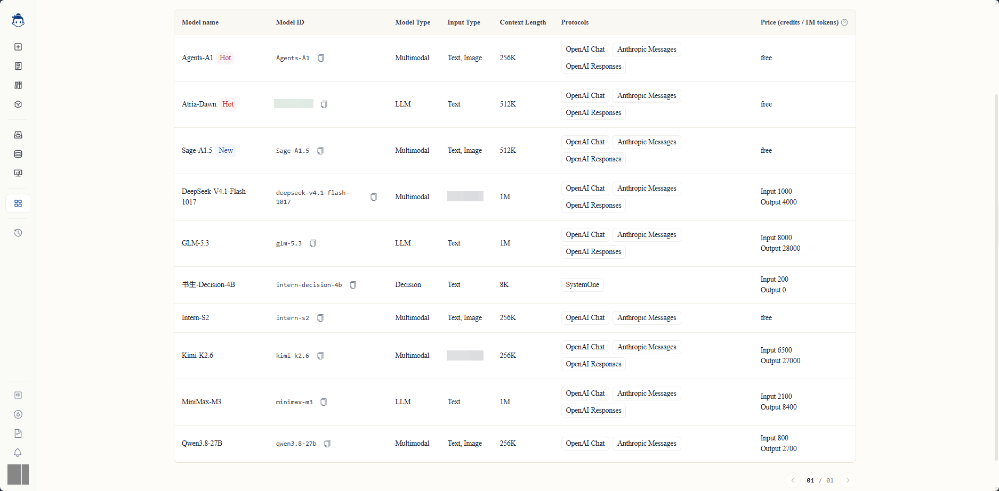

# dsh-modalities

你的模型明明写着能看图，DSH 却拒绝接收图片。这个插件修补两者之间的信息差。

<div align="center">

👉 选择语言：[English](./README.md) · **[中文](./README.zh-CN.md)**

</div>

<h1 align="center">
  
</h1>

<h3 align="center">让能看图的模型真正收到图片</h3>

<p align="center">
  <a href="#问题出在哪">问题出在哪</a> ·
  <a href="#怎么解决的">怎么解决的</a> ·
  <a href="#安装">安装</a> ·
  <a href="#配置">配置</a> ·
  <a href="#测试">测试</a> ·
  <a href="https://github.com/DF-Guan/dsh-modalities"><strong>源码</strong></a>
</p>

<p align="center">
  <a href="https://github.com/DF-Guan/dsh-modalities"></a>
  <a href="https://github.com/DF-Guan/dsh-modalities/blob/main/LICENSE"></a>
</p>

---

## 问题出在哪

在书生·端砚的模型页面上，**Sage-A1.5**、**Intern-S2**、**Qwen3.8-27B** 这些模型的「输入类型」一栏写的是 `Text, Image` —— 它们能看图：



但 DSH 通过网关 API 发现这些模型时，读到的是它不认识的能力格式。网关返回的是这样：

```json
{
  "id": "Sage-A1.5",
  "input_modalities": [
    { "type": "text" },
    { "type": "image" }
  ]
}
```

DSH 期望的是一串简单的词：`["text", "image"]`。它读不懂 `{ "type": "image" }` 这种写法，于是判定这个模型**没有任何输入能力声明**，自动降级成纯文本模型。

结果就是：

```
model "Sage-A1.5" does not declare image input
```

你的图片附件被拒绝了——而模型页面上明明白白写着它能看图。

## 怎么解决的

这个插件站在网关和 DSH 之间。它读取网关可能使用的任何一种能力声明格式，翻译成 DSH 能听懂的那串简单的词：

| 网关返回的格式 | DSH 最终收到的 |
|---|---|
| `["text", "image"]`（普通词列表） | `["text", "image"]` |
| `[{ "type": "text" }, { "type": "image" }]`（对象数组——书生·端砚的格式） | `["text", "image"]` |
| `{"architecture": {"input_modalities": ["text", "image", "file"]}}`（嵌套写法） | `["text", "image"]` |
| `{"inputModalities": ["text"]}`（驼峰写法） | `["text"]` |

它遵守两条规矩：

- **不编造能力。** 如果网关说某个模型支持 `file`、`audio` 或 `video`，这些会被丢弃——DSH 本来也发不了这些类型，声明了就是骗人。
- **不默认当纯文本。** 什么都没声明的模型保持"未知"，而不是静默降级成纯文本。你拿到的是诚实的"我不知道"，而不是一个错误的答案。

## 安装

```sh
dsh plugin --profile <name> add github:DF-Guan/dsh-modalities
```

就这一句。没有编译步骤，没有打包产物——插件就是纯 JavaScript，直接从源码运行。

## 配置

装完之后，在你的 profile 补丁文件（`cordis.patch.yml`）里加一行：

```yaml
- id: modality-gateway
  name: dsh-modalities
  config:
    endpoint: 'https://api.example.com/v1'
    apiKey: !!js process.env.MODALITY_API_KEY
    providers: [intern-modalities]
```

| 字段 | 含义 |
|---|---|
| `endpoint` | 网关的基础地址，就是那个能回答 `GET {endpoint}/v1/models` 的地址 |
| `apiKey` | 该网关的 API 密钥。设到 `MODALITY_API_KEY` 环境变量里，不要把真实值提交到仓库 |
| `providers` | 这个适配器负责的路线名称。`intern-modalities` 就是书生·端砚那条路线 |

适配器获取一次模型列表，缓存十分钟，期间所有请求都复用这份缓存——所以每十分钟一次网络请求，而不是每次生成都要请求。

## 测试

```sh
npm test
```

**47 条断言**，分布在三个文件，全部通过：

| 文件 | 测什么 | 断言数 |
|---|---|---|
| `tests/modality.spec.mjs` | 四种写法格式，加上容量字段和空输入 | 20 |
| `tests/provider.spec.mjs` | 列表解析、缓存命中/未命中、未知模型报错、流式输出 | 15 |
| `tests/sse.spec.mjs` | SSE 行解析、文本流、工具调用块 | 12 |

`tests/fixtures/gateway.json` 里的测试数据是照着书生·端砚的真实返回格式写的。这些测试证明的是**真正的那个 bug 被修好了**，而不是一个编出来的例子。

## 这是什么，以及这不是什么

**这是治标。** 真正的修复应该在 DSH 核心里（`packages/llm/llm-pi-ai/src/discovery.ts`），让它不管 `input_modalities` 写成什么形式都能读。一份等价的补丁已经做好，放在 fork 分支上，讨论见 [deepseek-harness Discussion #8876](https://github.com/deepseek-ai/deepseek-harness/discussions/8876)。

**这个插件适合这样的人：** 你想让图片附件今天就跑起来，等不了核心补丁落地。它是一个能用的适配器，不是概念验证——有测试、有缓存、有错误处理、有流式输出支持。

## 进度

| 事项 | 状态 |
|---|---|
| 插件 | `main` 分支，47 条测试通过 |
| 核心补丁（`discovery.ts`） | 已在 fork 分支准备好，讨论见 #8876 |
| 社区帖子 | [Discussion #11364](https://github.com/deepseek-ai/deepseek-harness/discussions/11364) |

---

<h2 align="center">🇬🇧 English version</h2>

<p align="center">
  Your model says it can read pictures. DSH says it can't. This plugin fixes the mismatch.
</p>

<p align="center">
  <strong><a href="./README.md">Read the full English version →</a></strong>
</p>
